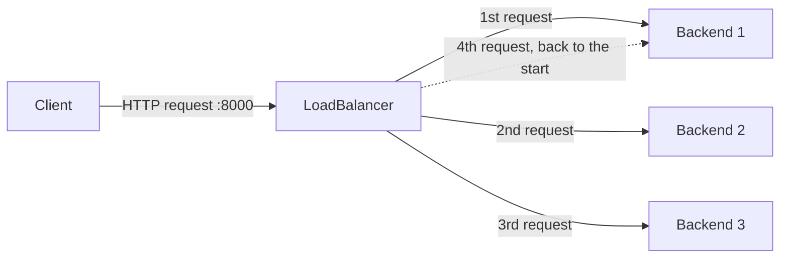

# Go Load Balancer

A small HTTP load balancer written in Go with only the standard library. It listens on one port and spreads incoming requests across a list of backend servers in round-robin order, forwarding each request through a reverse proxy.

I built it to understand what sits between a client and a pool of servers: how a request is proxied, how the next server is chosen, and how to keep that choice safe when many requests arrive at the same time.

## How it works



1. `http.HandleFunc("/", ...)` sends every request on port `8000` to the load balancer.
2. `getNextAvailableServer` picks the next server in the list (`roundRobinCount % len(servers)`) and moves the counter forward. A `sync.Mutex` protects the counter, so concurrent requests never read or update it at the same time.
3. The chosen server forwards the request with `httputil.NewSingleHostReverseProxy`, and the response goes straight back to the client.
4. If no server is available, the client gets `503 Service Unavailable`.

## Design

| Piece | Role |
| --- | --- |
| `Server` interface | What the balancer needs from a backend: `Address()`, `IsAlive()` and `Serve()`. Any backend type that implements it can be plugged in. |
| `SimpleServer` | A backend reached through a reverse proxy to a single URL. |
| `LoadBalancer` | Holds the port, the list of servers and the round-robin counter, guarded by a mutex. |

Keeping backends behind an interface separates *choosing* a server from *talking to* it, which is what makes features like health checks possible without touching the selection logic.

## Running it

Requirements: Go 1.16 or later.

```bash
git clone https://github.com/amarialeitao/go-load-balancer.git
cd go-load-balancer
go run main.go
```

Then send a few requests and watch the terminal: each one is logged with the backend it was forwarded to, in turn.

```bash
curl -s -o /dev/null http://localhost:8000
curl -s -o /dev/null http://localhost:8000
curl -s -o /dev/null http://localhost:8000
```

```
Serving requests at 'localhost:8000'
Forwarding request to address https://www.facebook.com
Forwarding request to address http://www.bing.com
Forwarding request to address https://www.google.com
```

The backends are set in `main()`. Public sites often reject or redirect proxied requests, because the proxy keeps the original `Host` header, so the rotation is easiest to see with your own services: replace the three URLs with local servers, for example `http://localhost:8081`, `http://localhost:8082` and `http://localhost:8083`.

## Limitations and next steps

This is a learning project, and these are the gaps I would close next:

- **Health checks:** `IsAlive()` always returns `true`. A real check would ping each backend periodically and skip the ones that fail.
- **Configuration:** the port and backends are hard-coded. They could come from flags or a config file.
- **Tests:** add unit tests for the round-robin order and for concurrent access to the counter.
- **Go module:** add a `go.mod` file so the project builds with standard Go tooling.
- **Other strategies:** least connections or weighted round-robin, behind the same interface.

## License

[MIT](LICENSE)
