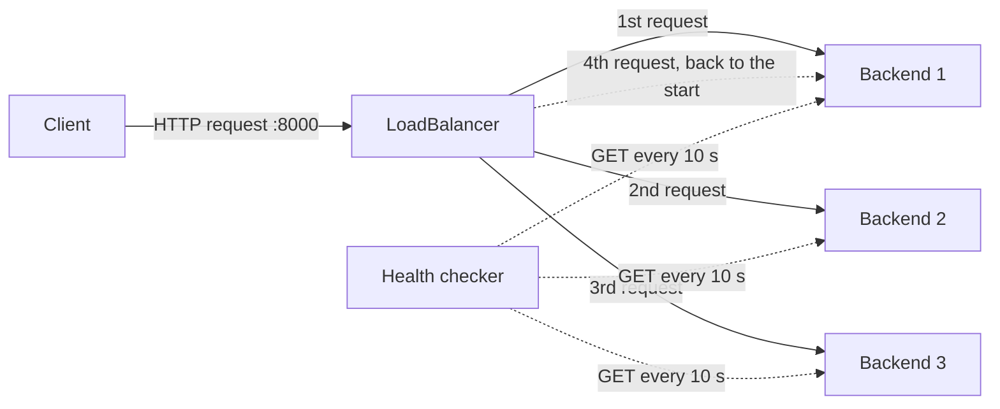

# Go Load Balancer

[](https://github.com/amarialeitao/go-load-balancer/actions/workflows/test.yml)


[](LICENSE)

A small HTTP load balancer written in Go with only the standard library. It listens on one port and spreads incoming requests across a list of backend servers in round-robin order, forwarding each request through a reverse proxy.

I built it to understand what sits between a client and a pool of servers: how a request is proxied, how the next server is chosen, and how to keep that choice safe when many requests arrive at the same time.

## How it works



1. `http.HandleFunc("/", ...)` sends every request on port `8000` to the load balancer.
2. `getNextAvailableServer` picks the next server in the list (`roundRobinCount % len(servers)`), moves the counter forward and skips any server that is down. A `sync.Mutex` protects the counter, so concurrent requests never read or update it at the same time.
3. The chosen server forwards the request with `httputil.NewSingleHostReverseProxy`, and the response goes straight back to the client.
4. If every server is down, the client gets `503 Service Unavailable`.

### Health checks

Each backend is checked in two ways:

- **Active:** every 10 seconds (and once at startup), the balancer sends a `GET` to each backend with a 2-second timeout. Any response below `500` means the server is up; a timeout, a network error or a `5xx` response means it is down. A server that comes back is put back into the rotation on the next check. Every change of state is logged, for example `Health check: http://localhost:8082 is DOWN`.
- **Passive:** if forwarding a request fails, that backend is taken out of the rotation immediately and the client gets `502 Bad Gateway`, without waiting for the next periodic check.

## Design

| Piece | Role |
| --- | --- |
| `Server` interface | What the balancer needs from a backend: `Address()`, `IsAlive()` and `Serve()`. Any backend type that implements it can be plugged in. |
| `HealthChecker` interface | Optional: backends that implement `CheckHealth()` are checked periodically. |
| `SimpleServer` | A backend reached through a reverse proxy to a single URL. It keeps its own up/down state behind a `sync.RWMutex` and implements both interfaces. |
| `LoadBalancer` | Holds the port, the list of servers and the round-robin counter, guarded by a mutex. |

Keeping backends behind interfaces separates *choosing* a server from *talking to* it and from *checking* it, so health checks were added without changing how the next server is picked.

## Running it

Requirements: Go 1.21 or later.

```bash
git clone https://github.com/amarialeitao/go-load-balancer.git
cd go-load-balancer
go run .
```

Then send a few requests and watch the terminal: each one is logged with the backend it was forwarded to, in turn.

```bash
curl -s -o /dev/null http://localhost:8000
curl -s -o /dev/null http://localhost:8000
curl -s -o /dev/null http://localhost:8000
```

```
Serving requests at 'localhost:8000'
Forwarding request to address https://www.facebook.com
Forwarding request to address http://www.bing.com
Forwarding request to address https://www.google.com
```

To see the health checks working, point the balancer at local servers, stop one of them and watch it leave the rotation; start it again and it comes back within 10 seconds.

The backends are set in `main()`. Public sites often reject or redirect proxied requests, because the proxy keeps the original `Host` header, so the rotation is easiest to see with your own services: replace the three URLs with local servers, for example `http://localhost:8081`, `http://localhost:8082` and `http://localhost:8083`.

## Tests

```bash
go test -race ./...
```

The tests cover the round-robin order, skipping servers that are down, the `503` when no server is available, active health checks (a backend going down, a `5xx` response, a backend coming back) and the passive check after a failed request. A concurrency test sends 300 parallel selections and checks that each of the three servers gets exactly 100. GitHub Actions runs `go vet` and the tests on every push and pull request.

## Limitations and next steps

- **Configuration:** the port, the backends and the health check interval are hard-coded. They could come from flags or a config file.
- **Health check endpoint:** checks hit each backend's base URL. A dedicated path such as `/health` would avoid loading full pages.
- **Other strategies:** least connections or weighted round-robin, behind the same interface.

## License

[MIT](LICENSE)
